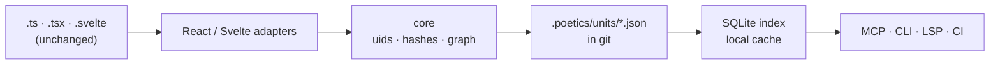

<div align="center">

# Poetics

**Every function, hook and component, versioned with its own history, rationale, docs and tests.**

An agent-first TypeScript framework for React and Svelte codebases.

[](https://github.com/Pixerate/poetics/actions/workflows/ci.yml)
[](LICENSE)


</div>

> "The idea becomes a machine that makes the art."
> — Sol LeWitt, *Paragraphs on Conceptual Art* (1967)

A developer or agent supplies the idea and the procedure. Poetics is the machine
that records how each piece of code was made, by whom, and why.

**[See it running on its own codebase →](https://pixerate.github.io/poetics/)**
Every function and type in this repository, with its history, rationale,
tests and gotchas, generated from `.poetics/` on each push.

## Why

Coding agents forget between sessions, spend context finding things, and follow
procedure well when someone writes it down. Poetics gives them:

- **Durable memory tied to code.** Each unit (function, hook, component, type)
  carries its rationale, version history, provenance and linked tests, so a new
  session starts informed.
- **Exactly the right context.** Context packs hand over the slice of the
  codebase a task touches, within a token budget.
- **Precise impact.** A component's closure version changes when anything it
  depends on changes, so "what could this edit break?" has an exact answer.
- **Procedure as skills.** Recording rationale, declaring renames and updating
  tests become routine steps an agent follows.

Humans get the same through a CLI, git hooks, an editor extension and pull
request reports.

## How it works



- **Text stays the source of truth.** Source files are ordinary; delete
  `.poetics/` and you have a normal project.
- **One JSON file per unit, in git**, so metadata travels with branches and
  rarely conflicts. A disposable SQLite index makes it fast to query.
- **Stable identity.** Each unit gets a ULID that survives renames and moves.
  Content and interface hashes tell a real change from a reformat, and a
  breaking change from an internal one.

Read the full design in [`docs/plan.md`](docs/plan.md).

## Status

Poetics is in its **seed phase**: the formats, skills and typed stubs exist, and
Poetics records its own history by hand while the tools are built.

| | Today |
| --- | --- |
| JSON Schemas for units, config and lock | ✅ |
| Store validation (`pnpm validate`) and the SQLite index | ✅ |
| Agent skills (`.claude/skills/`) | ✅ day-one versions |
| `@poetics/core`, adapters, MCP server, CLI | 🧱 typed stubs |
| Indexer, closure hashes, impact reports | Phase 1 |

Packages are not published to npm yet.

## Quick start (contributors)

Requires Node 24.15+ and pnpm 12 (via Corepack).

```bash
corepack enable
```

```bash
pnpm install
```

```bash
pnpm preflight
```

`pnpm preflight` runs type checks, `sv check`, unit tests, store validation and
the build. See [Getting started](docs/getting-started.md) for every command.

## Packages

| Package | Purpose |
| --- | --- |
| [`@poetics/core`](packages/core) | Unit model, uids, hashing, composition graph |
| [`@poetics/store`](packages/store) | `.poetics/` JSON store, validation, SQLite index |
| [`@poetics/adapter-react`](packages/adapter-react) | Components, hooks and functions in `.ts`/`.tsx` |
| [`@poetics/adapter-svelte`](packages/adapter-svelte) | Components and functions in `.svelte`/`.svelte.ts` |
| [`@poetics/mcp`](packages/mcp) | MCP server for coding agents |
| [`@poetics/cli`](packages/cli) | `poetics` command line, with `--json` |

## Documentation

- [Developer documentation](docs/README.md): architecture, data model, testing,
  CI and releases
- [`AGENTS.md`](AGENTS.md): rules for agents and humans, including how to commit
- [Demo site](https://pixerate.github.io/poetics/) ([how it's built](docs/demo.md))
- [`GOTCHAS.md`](GOTCHAS.md): known pitfalls and workarounds, generated from anchored notes in `.poetics/notes/`
- [Decision records](docs/decisions/README.md)

## Contributing

See [`CONTRIBUTING.md`](CONTRIBUTING.md). Every change ships with unit tests,
records itself in `.poetics/`, and adds a changeset when a package changes.

## License

[MIT](LICENSE) © 2026 Jack James
