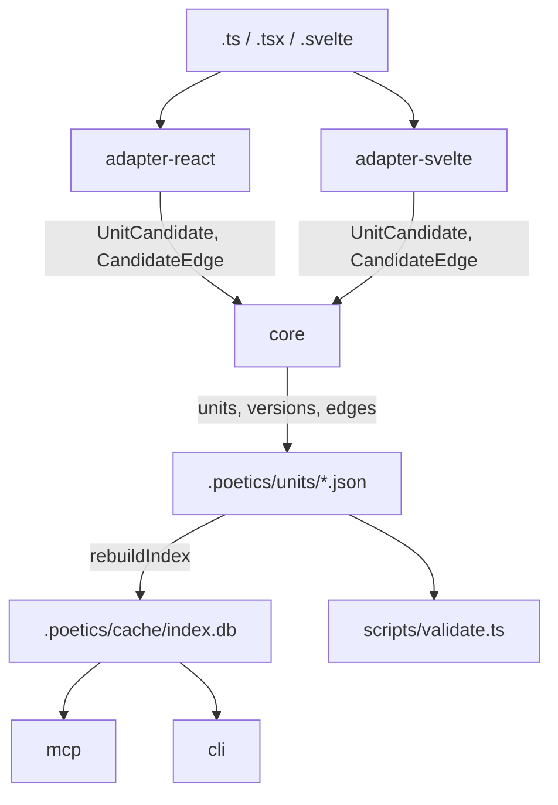

# Architecture

Poetics is a set of npm packages around one framework-neutral core. Adapters are
the only code that knows React or Svelte exist. See the [plan](plan.md) for the
full design; this page describes what exists in the repository today.



## Packages

| Package | Built today | Stubbed (throws `NotImplementedError`) |
| --- | --- | --- |
| `@poetics/core` | Model types, `mintUid`, `isUid`, `uidTime`, `gitBlobHash`, `isHash`, `FrameworkAdapter` interface | `contentHash`, `interfaceHash`, `closureHash`, graph construction, SCCs, closure hashes, impact |
| `@poetics/store` | Store paths and sharding layout, JSON Schema validation, `checkStore`, reading unit files, the incremental SQLite index with lookups and reverse dependencies | Validated writes (`appendVersion`, `recordRationale`, `declareLineage`, `linkTest`, `setDocs`), FTS search |
| `@poetics/adapter-react` | Hook and component naming rules | Detection, interfaces, edges |
| `@poetics/adapter-svelte` | File-kind detection, component naming, Svelte 4/5 detection | Detection, interfaces, edges |
| `@poetics/mcp` | Tool definitions with input schemas and access levels | Server and tool handlers |
| `@poetics/cli` | `help`, `--version`, `--json`, exit codes | Every command |

Later packages from the plan (`skills`, `evals`, `testlink`, `lsp`, `action`,
`storybook-addon`, `tracker-*`, `monitor-sentry`, `release`) are added when their
phase starts.

## Conventions

- **Stubs are units.** Every planned public API exists as a typed function that
  throws `NotImplementedError`, and has a unit file. Its history starts at design
  time.
- **Pure core.** `@poetics/core` does no I/O except hashing helpers. File and
  database access lives in `@poetics/store`.
- **Structured output first.** Every capability is shaped for agents (typed
  results, `--json`) before it gets human formatting.
- **Data, never instructions.** Anything that returns docs, rationale, issue text
  or error messages to an agent marks it as data
  (`DATA_NOT_INSTRUCTIONS` in `@poetics/mcp`).

## Module resolution

Packages are ESM. Each exports a `poetics-source` condition pointing at
`src/index.ts` and default/types conditions pointing at `dist/`:

```json
"exports": {
  ".": {
    "poetics-source": "./src/index.ts",
    "types": "./dist/index.d.ts",
    "default": "./dist/index.js"
  }
}
```

Inside the repository, `tsc` (`customConditions`), Vitest (`resolve.conditions`)
and the scripts (`node --conditions=poetics-source`) all resolve workspace
packages to source, so nothing needs building before tests or scripts run.
Published consumers never see the condition and get `dist/`.
