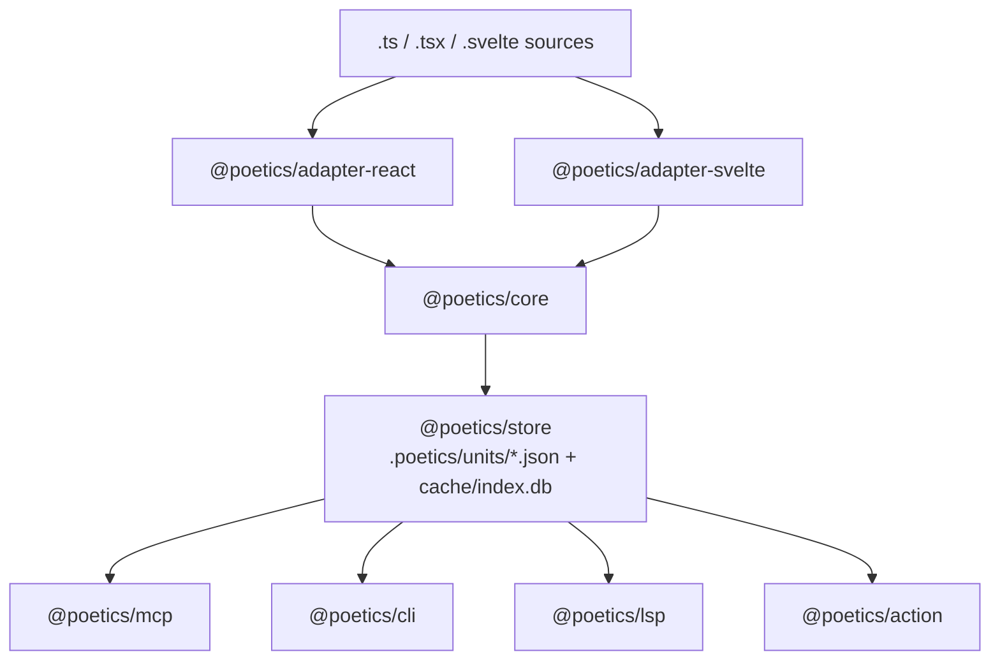

# Poetics: Implementation Plan

Oct 24, 2026 · @Someone

> Kept current in the repo. Changes since the original: the metadata store is a hybrid of git-tracked JSON and a local SQLite index ([ADR 0002](decisions/0002-hybrid-json-sqlite-store.md)), and a unit's first version has change class `created`.

## Summary

Build an agent-first TypeScript framework, **Poetics**, which treats every function, hook and component in a React or Svelte codebase as a versioned unit carrying its own authorship, rationale, docs and tests. Coding agents are the primary users: they reach everything through an MCP server and a set of skills that teach them when and how to use it. Source files stay ordinary `.ts`, `.tsx` and `.svelte`; the metadata lives in a git-tracked sidecar.

The name follows Sol LeWitt's procedural account of conceptual art in *Paragraphs on Conceptual Art* (1967): "The idea becomes a machine that makes the art." In Poetics, a developer or agent supplies the idea and the procedure, and the framework is the machine that records how each piece of code was made, by whom and why.

Design principles:

- **Agents first, humans equally served.** Every capability is an MCP tool with structured output before it is a CLI command or editor feature. Skills package the workflows an agent should follow.
- **Metadata is agent memory.** Rationale, history and test links are durable context tied to code, so a new agent session starts informed instead of guessing.
- **Text stays the source of truth.** Compilers, bundlers, git hosts and CI see no change. Deleting the `.poetics/` folder leaves a normal working project.
- **Opt-in and incremental.** A team can adopt it on one package of a monorepo and expand.
- **Git is the transport.** Metadata travels with commits and branches; no server is required.
- **One core, thin framework adapters.** Everything framework-specific sits behind an adapter, so React and Svelte share the same model, store and tools.
- **Components are units that compose units.** A component's version reflects its own code; a separate closure version reflects everything it depends on.

## Core model

Everything Poetics tracks is a **unit** with one stable identity and a chain of content-addressed versions.

| Unit kind | React | Svelte | Interface (what callers depend on) |
| --- | --- | --- | --- |
| Function | Any exported or module-level function | Functions in `<script>`, `<script module>` and `.svelte.ts` files | Parameter and return types |
| Hook / rune helper | `use*` functions | Functions that create or return runes state | Parameters and returned shape |
| Component | Function or class components, including `memo` and `forwardRef` wrappers | Each `.svelte` file | Props, events or callback props, slots or snippets, ref type |
| Type | Exported `type` and `interface` | Same | The type's structure |

Each unit has three identifiers:

- **`uid`** — a ULID minted the first time Poetics sees the unit. It never changes, even across renames and moves, and is what metadata hangs on.
- **`contentHash`** — a hash of the unit's normalised syntax tree, with comments and formatting stripped. Running Prettier never creates a version; changing logic always does.
- **`interfaceHash`** — a hash of the unit's public signature only. When it changes, the version is flagged as breaking for callers.

A **version** is a `(uid, contentHash)` pair with a pointer to its parent version, the commit that introduced it, and a change class: `created` (the unit's first version), `interface` (breaking), `behaviour` (body changed) or `cosmetic` (types or docs only).

Units form a **composition graph**. An edge records that unit A uses unit B: a component renders a child component, calls a hook, or calls a utility function. Each edge records which version of B was current when A's version was captured. This graph is what lets a component's version account for the functions it composes (see Composition and version propagation).

## Architecture

Poetics is a set of npm packages around one framework-neutral core; the adapters are the only parts that know React or Svelte exist.



Source files flow down through an adapter into the core, which writes versions to the store; every developer-facing tool reads from that store.

| Package | Responsibility |
| --- | --- |
| `@poetics/core` | Unit model, BLAKE3 hashing, composition graph, closure computation |
| `@poetics/mcp` | MCP server: context packs, search, impact, and validated writes for rationale and lineage |
| `@poetics/skills` | Agent skills and the `AGENTS.md` pointer, installed by `poetics init --agents` |
| `@poetics/evals` | Benchmark tasks and harness for measuring agents with and without Poetics |
| `@poetics/adapter-react` | Component, hook and function detection in `.ts` and `.tsx` |
| `@poetics/adapter-svelte` | Same for `.svelte` and `.svelte.ts`, via `svelte2tsx` |
| `@poetics/store` | Reads and writes `.poetics/`, git merge driver |
| `@poetics/testlink` | Vitest and Jest coverage reporter that maps tests to units |
| `@poetics/cli` | Command-line interface with `--json` output, and git hooks |
| `@poetics/lsp` | Language server, plus a thin VS Code extension |
| `@poetics/action` | GitHub Action for pull request reports |
| `@poetics/storybook-addon` | Version and rationale panel for stories |
| `@poetics/tracker-github` | GitHub Issues and pull request adapter: reference parsing, lookups, report comments |
| `@poetics/tracker-uchiage` | Uchiage task adapter linking tasks, agent sessions and unit versions |
| `@poetics/monitor-sentry` | Resolves Sentry stack frames to unit versions |
| `@poetics/release` | Changesets integration for bump types and changelog entries |

Poetics uses the TypeScript compiler API rather than a syntax-only parser such as tree-sitter. Interface hashes need resolved types, and edges need cross-file symbol resolution, which only the checker provides. Tree-sitter can be added later as a fast pre-pass to skip unchanged files.

## Framework adapters

Both adapters feed the same TypeScript type checker, so a Svelte component calling a shared `.ts` utility resolves to the same unit as a React component calling it. An adapter answers four questions: which nodes are units, what each unit's interface is, what it uses, and where its source span is.

### React (`.ts`, `.tsx`)

- **Parsing:** the TypeScript compiler API via ts-morph, so types and symbol references resolve exactly as `tsc` sees them.
- **Component detection:** a PascalCase function or arrow function that returns JSX; anything wrapped in `memo`, `forwardRef` or `lazy`; classes extending `Component`. Hooks are functions named `use` + capital letter.
- **Interface:** the resolved props type from the first parameter, plus the ref type for `forwardRef`. Default prop values count as interface, since changing one changes behaviour for callers that omit it.
- **Edges:** JSX elements resolve to component units; calls resolve to function and hook units; context providers and consumers are recorded as edges to the context object.

### Svelte (`.svelte`, `.svelte.ts`)

- **Parsing:** `svelte2tsx` (the same transform `svelte-check` uses) turns each component into TSX with source maps. Poetics indexes that output with the same checker, then maps spans back to the original file.
- **Component detection:** each `.svelte` file is one component unit. Functions declared in its scripts become child units owned by it.
- **Interface, Svelte 5:** the type of the `$props()` destructure, including callback props and snippet props.
- **Interface, Svelte 4:** `export let` declarations, `createEventDispatcher` event types, and named slots. Supporting both keeps mixed-version codebases working during migration.
- **Edges:** components used in markup, functions called in template expressions and `{@render}` targets all resolve through the generated TSX.
- **`.svelte.ts` files** with runes are indexed as ordinary TypeScript modules.

### Where neither adapter can see

Dynamic components (`<svelte:component this={x}>`, a JSX element chosen from a map), higher-order components and render props can hide what is actually rendered. Poetics records these as **unresolved edges** rather than guessing, and shows them in impact reports so reviewers know where the graph is incomplete.

## Composition and version propagation

Every unit carries two versions: an **own version** that changes only when its code changes, and a **closure version** that changes when it or anything it depends on changes. This answers both "did someone edit this component?" and "could this component now behave differently?".

The closure hash is a Merkle hash, computed bottom-up over the composition graph:

```
closureHash(u) = hash(contentHash(u) + sorted closureHash(d) for each dependency d)
```

Example: `formatPrice()` changes. Its own and closure versions bump. `PriceTag` and `useCart` call it, so their closure versions bump while their own versions stay put. `CheckoutPage` renders `PriceTag`, so its closure version bumps too. Nothing else in the app is touched.

Rules that keep this predictable:

- **Interface changes propagate as warnings.** If `formatPrice`'s interface hash changes, every direct caller is flagged as needing review, even though TypeScript may still compile.
- **Cycles** (mutually recursive functions, components that render each other) are collapsed into one strongly connected component and hashed together.
- **npm dependencies** are leaf nodes whose hash is `package@version` from the lockfile, so upgrading a library shows up in every affected component's closure.
- **Optional pinning:** a `poetics.lock` can record the closure hash of each exported component. Design-system teams can use it to see exactly which published components changed between releases, and CI can fail if a closure changes without a version bump.

The practical payoff is a precise **impact report**: for any change, the list of components whose behaviour may have changed, ranked by distance from the edit.

## Metadata schema and storage

Metadata lives in a `.poetics/` folder at the repo root, as **one JSON file per unit**, so two people editing different functions never conflict. The JSON files are the source of truth; a **local SQLite index** is rebuilt from them for fast lookups, search and the reverse dependency index ([ADR 0002](decisions/0002-hybrid-json-sqlite-store.md)).

```
.poetics/
  config.json            # adapters, include/exclude globs, policy
  units/
    01JB8K…Q3.json       # one file per unit, named by uid
  poetics.lock           # optional closure pins for exported components
  cache/                 # gitignored, disposable
    index.db             # SQLite index rebuilt from units/ (node:sqlite)
```

A unit file:

```json
{
  "uid": "01JB8K…Q3",
  "kind": "component",
  "framework": "svelte",
  "name": "PriceTag",
  "location": { "file": "src/lib/PriceTag.svelte" },
  "versions": [
    {
      "contentHash": "b3:9f2c…",
      "interfaceHash": "b3:41aa…",
      "closureHash": "b3:c07e…",
      "parent": "b3:77d1…",
      "change": "behaviour",
      "commit": "a1b2c3d",
      "actor": {
        "kind": "agent",
        "tool": "claude-code",
        "model": "<model id>",
        "session": "ses_8f…",
        "reviewed": false
      },
      "rationale": "Show strikethrough price during sales",
      "links": ["https://tracker.example/SHOP-412"],
      "deps": { "01JB7Z…F1": "b3:5e10…" }
    }
  ],
  "lineage": [{ "kind": "move", "from": "src/components/PriceTag.svelte", "commit": "9e8d7c6" }],
  "docs": "Displays a price with currency and optional sale price.",
  "tests": [{ "file": "src/lib/PriceTag.test.ts", "name": "shows sale price", "via": "coverage" }]
}
```

Decisions behind this layout:

- **Human authorship and dates come from git**, via the recorded commit, so there is one source of truth.
- **Agent provenance is stored**, because git only records who committed, not which agent session, model or task produced a change. The `reviewed` flag lets policy treat agent-written rationale differently until a human approves it.
- **Rationale is stored per unit**, because a commit message describes a whole commit while a rationale describes one unit's change. It defaults to the commit message.
- **Lineage is stored** when an agent or human declares a rename, move, split or merge, so identity never depends on heuristics alone.
- **`versions` is append-only.** A custom git merge driver unions version entries by `contentHash`, so branch merges almost never need manual resolution.
- **Derived data stays out of git.** The SQLite index, spans, the reverse dependency index and search embeddings are rebuilt locally in `cache/`. Rebuilds are incremental (unit files whose bytes are unchanged are skipped) and deleting `cache/` always yields an identical index.
- **Sharding for very large repos.** If a monorepo reaches tens of thousands of units, `store.layout: "sharded"` moves files to `units/<first two uid characters>/<uid>.json`, the way git stores objects. Nothing else changes.

## Tests and docs as metadata

Tests and docs stay in the files existing tools expect; Poetics owns the **links** between them and units, which is what makes them part of a unit's metadata without breaking Vitest, Jest, Testing Library, Playwright or Storybook.

### Linking tests to units

1. **Static links:** a test file that imports a unit and calls or renders it is linked to that unit. Cheap and immediate, but coarse.
2. **Coverage links:** Poetics runs the suite with V8 coverage per test, maps covered ranges onto unit spans, and records exactly which tests exercise which units, including indirect use through a parent component.
3. **Explicit links:** an optional `poetics.covers(PriceTag)` call inside a test for cases the first two miss, such as end-to-end tests.

Each link records the unit version it was last verified against. When a unit gets a new `behaviour` or `interface` version and none of its linked tests changed or ran green against it, the unit is marked **unverified**.

### Storybook

Stories are linked to components the same way as tests. A small Storybook addon shows each story's component version, its rationale history and whether its closure changed since the story was last reviewed.

### Docs

Docs are stored on the unit and written back into source on demand with `poetics docs sync`, so editors and IDEs show them natively:

- **React and TypeScript:** a TSDoc block above the function or component.
- **Svelte:** the `<!-- @component -->` comment that Svelte's language tools already show on hover.

Because the stored docs are tied to a version, Poetics can flag docs as stale when a unit's interface changes but its docs do not.

## Developer workflow and tooling

Humans and agents share the same surfaces: the CLI, git hooks and CI below serve both, and every CLI command takes `--json` so agents without MCP can use it. The agent-specific layer is described in Agent interface.

### CLI

| Command | What it does |
| --- | --- |
| `poetics init` | Detects React and Svelte, writes `config.json`, indexes the repo and backfills history from git |
| `poetics index` | Incremental re-index of changed files; run by the git hook |
| `poetics log <unit>` | Version history of one function or component, with rationale and commits |
| `poetics why <unit>` | The rationale chain that led to the current version |
| `poetics impact [ref]` | Components whose closure changed since a branch or commit |
| `poetics diff <unit> <a> <b>` | Semantic diff between two versions of a unit, ignoring moves and formatting |
| `poetics verify` | Lists unverified units, stale docs and unresolved edges; non-zero exit for CI |
| `poetics docs sync` | Writes stored docs into TSDoc and `@component` comments |

### Git integration

- A **post-commit hook** runs `poetics index` and appends new versions.
- A **prepare-commit-msg hook** lists changed units so the developer can give per-unit rationale where the commit message isn't enough. An optional LLM step drafts rationale from the diff and linked ticket for the developer to accept or edit.
- **History backfill:** `poetics init` walks past commits so units start with real history, not a blank slate.

### Editor

A standalone language server runs beside the TypeScript and Svelte language servers, so it works in VS Code, JetBrains and Neovim without patching either:

- CodeLens above each unit: version count, last change, linked test count and status.
- Hover: rationale for the current version and its interface.
- A history panel to step through a single function's versions.
- Diagnostics for unverified units and stale docs.

### CI

A GitHub Action posts an impact report on each pull request: units changed with their change class, interface breaks and their direct callers, components whose closure changed, and units changed without passing linked tests.

## Agent interface

Agents use Poetics through an MCP server with structured, token-budgeted output and a set of skills that tell them which tools to call at each step of a task. The same operations are available as `poetics --json` for agents without MCP.

### Why agent-first

- **Agents forget between sessions.** Unit rationale and history are durable memory attached to the code itself, not to a chat log.
- **Agents waste context finding things.** A context pack hands over exactly the slice of the codebase a task touches.
- **Agents follow procedure reliably.** Recording rationale, declaring lineage on refactors and updating linked tests are chores humans skip; a skill makes them routine for an agent.

### MCP server (`@poetics/mcp`)

| Tool | What it returns or does | Access |
| --- | --- | --- |
| `poetics_context_pack` | For a unit or a task description: the unit's code, signature, docs and latest rationale, plus the signatures of its callers and dependencies and its linked tests, trimmed to a token budget | Read |
| `poetics_search` | Units matching a query across names, docs and rationale | Read |
| `poetics_unit`, `poetics_history` | One unit's current state, or its version chain with rationale and provenance | Read |
| `poetics_impact` | Components whose closure changed since a ref, or would change if a unit changed | Read |
| `poetics_tests_for` | Linked tests for a unit and whether they pass on its current version | Read |
| `poetics_verify` | Unverified units, stale docs, unresolved edges in a scope | Read |
| `poetics_record_rationale` | Attaches rationale and links to a unit's newest version | Write |
| `poetics_declare_lineage` | Declares a rename, move, split or merge so identity and history carry over | Write |
| `poetics_link_test`, `poetics_set_docs` | Adds a test link or updates a unit's docs | Write |
| `poetics_signals` | Linked issues, review notes and production errors for a unit, newest first | Read |

Write rules: every write is append-only, attributed to the calling agent session, and checked against the indexer. A lineage declaration that doesn't match what the diff shows is rejected. No tool can delete or rewrite history.

### Skills (`@poetics/skills`)

| Skill | When the agent uses it | What it makes the agent do |
| --- | --- | --- |
| `poetics-orient` | Before changing any unit | Pull a context pack, read the rationale chain, check callers and unverified flags |
| `poetics-change` | Editing a function, hook or component | Classify the change, update linked tests and docs, record per-unit rationale |
| `poetics-refactor` | Renaming, moving, splitting or merging units | Declare lineage before committing so identity survives |
| `poetics-react-component` | Creating or editing React components | Typed props, named exports, hooks named `use*`: shapes the React adapter resolves precisely |
| `poetics-svelte-component` | Creating or editing Svelte components | Typed `$props()`, callback props for events, snippets over slots |
| `poetics-review` | Reviewing a diff or pull request | Run impact, list interface breaks and unverified units, judge rationale quality |
| `poetics-debug` | Tracking down a regression | Walk a component's closure versions to find which unit version changed behaviour |

`poetics init --agents` installs the skills into the repo (for example `.claude/skills/`), adds a short `AGENTS.md` pointer for agents that read that convention, and registers the MCP server. An example skill:

```markdown
---
name: poetics-refactor
description: Use before renaming, moving, splitting or merging any function, hook or component in a Poetics repo, so the unit keeps its identity and history.
---

1. Call poetics_unit for every unit you will touch and note each uid.
2. Make the code change.
3. Run poetics index, then call poetics_declare_lineage with the old uids,
   the new locations and the kind (rename, move, split or merge).
4. If it is rejected, read the reason, fix the declaration, and retry once.
   Never work around it by deleting units.
5. Call poetics_record_rationale on each resulting unit, then poetics_verify.
```

### Agent provenance

Each version records who produced it: a human, or an agent with its tool, model, session id and task link. Teams can set policy on that, for example marking agent-written rationale as unreviewed until a human approves the pull request, or requiring human sign-off on any interface change made by an agent.

### Measuring it

Poetics ships an eval suite: benchmark tasks on sample React, Svelte and mixed repos (feature changes, refactors, regression hunts), run by agents with and without Poetics. It compares task success, tokens used and whether lineage and rationale survive. Every skill and tool-description change is gated on it.

## Integrations

The integrations worth building first connect Poetics to where the reason for a change already lives (issues and code review) and where its consequences show up (production errors and releases). Each sits behind a small adapter, so the core stays tool-neutral.

| Integration | What flows in | What flows out | Phase |
| --- | --- | --- | --- |
| Issue trackers: GitHub Issues first, then Uchiage, Linear, Jira | Issue references from commits and PRs; issue text as agent context | Impact reports posted on the issue | 2 and 5 |
| Pull requests and reviews | Review comments on lines inside a unit | Impact report and unverified units on the PR | 5 |
| Error monitoring: Sentry first | Production stack frames, resolved to unit versions | Error signals in agent tools and PR reports | 5 |
| Release tooling: Changesets | Changeset files | Suggested bump type and changelog entries per package | 5 |

### Issue trackers

- **Inbound linking:** references such as `Fixes #123` in commits and pull requests attach the issue to every unit version the change produced.
- **References, not content:** metadata stores a typed reference (`{ kind, ref, url }`); titles and bodies are fetched on demand, so private issue text never enters git history and never goes stale.
- **Issue-driven context:** `poetics_context_pack` accepts an issue reference. It returns the units the issue likely touches, from names, paths and stack traces in the issue plus search over docs and rationale, and the past issues that changed those same units.
- **Grounded rationale:** the `poetics-change` skill drafts each unit's rationale from the linked issue and the diff, and cites the issue.
- **Reporting back:** when a linked PR merges, the GitHub Action comments on the issue with units changed, interface breaks and affected components.
- **Reverse lookup:** `poetics why <unit>` shows the chain of issues behind a unit, which makes regression triage much faster.
- **Optional auto-filing:** `poetics verify` findings can be opened as labelled issues for agents to pick up.

Uchiage is the second adapter. Tasks orchestrated in Uchiage carry their task ID into agent sessions, so provenance links task, agent session and unit versions in both directions. The adapter interface stays small: parse references, resolve a reference to its title, body and status, and post a comment.

### Pull requests and reviews

Review comments anchored to lines inside a unit are linked to the version under review. When a reviewer explains why code must stay a certain way, that note joins the unit's history, so a later agent sees it before repeating the mistake.

### Error monitoring

Poetics resolves production stack frames to units using the release's source maps and the commit it was built from. That gives three things:

- **Attribution:** an error is tied to a unit version, not just a file and line.
- **Deploy regressions:** new errors after a release point to the units whose own or closure version changed in it.
- **Better debugging:** the `poetics-debug` skill starts from real failures rather than a description.

Sentry comes first because it already handles source maps and releases; OpenTelemetry can follow.

### Release tooling

For component libraries, Poetics knows exactly which exported components had interface or behaviour changes. A Changesets integration proposes the bump type for each package, drafts changelog entries from per-unit rationale, and warns in CI when a changeset understates an interface change.

### Later

- **Design tools such as Figma:** link a component unit to its design source so agents see the intended design beside the code.
- **Feature flags:** record which units sit behind which flag, to scope impact reports.
- **OpenTelemetry:** tag spans with unit uid and version to catch performance regressions.

Rules for every integration: text from issues, reviews and error messages reaches agents as data, never as instructions, and credentials come from the platform's app tokens, never from `.poetics/`.

## Building Poetics with Poetics

Poetics is its own first user from the first commit. The data formats and skills come before the tools: agents write the metadata by hand by following the skills, and each tool, as it lands, takes over a job the skills already describe.

### Outputs before tooling

The first deliverable is the schema, not the indexer. Once the formats are fixed, everything downstream can be produced by hand and checked automatically:

- **JSON Schemas** for unit files, config and `poetics.lock`, validated in CI by a short script. This is the only tool on day one.
- **Hand-written units:** agents mint uids, create unit files and append versions themselves, following the skills.
- **Provisional hashes:** at first, a version's hash is the git blob hash of the unit's source text, marked `provisional: true`. The phase 1 indexer computes real hashes and keeps the history.
- **One compatibility rule:** everything written by hand must load into the real tools unchanged, apart from provisional hashes. The indexer's first job is to reconcile the hand-written store with the code, which makes Poetics' own history the first test corpus for the phase 1 gate.

### The bootstrap ladder

| Job | Day one, by hand | Taken over by | Phase |
| --- | --- | --- | --- |
| Assign identity | Agent mints a ULID and creates the unit file | Indexer | 1 |
| Version hashes | Provisional git blob hash | Normalised syntax-tree hash, with a rehash migration | 1 |
| Gather context | Agent reads unit files and the linked plan sections | `poetics_context_pack` | 1 |
| Check the store | JSON Schema validation in CI | `poetics verify` | 1 |
| Record rationale | Agent writes it into the unit file, per `poetics-change` | `poetics_record_rationale` | 2 |
| Record lineage | Agent adds a lineage entry, per `poetics-refactor` | `poetics_declare_lineage`, checked against the diff | 2 |
| Link tests | Explicit entries in the unit file | Coverage-based linking | 4 |

Skills are written for day one and rewritten as each rung lands: a step that says "append a version entry to the unit file" becomes "call `poetics_record_rationale`". Once the eval suite exists, skill rewrites go through it like any other change.

### Encoding the plan in the repo

This document becomes the repo's seed, with each part stored in the format where it belongs:

- **Packages and public APIs:** typed interface stubs, `.ts` files whose functions throw "not implemented". Each stub is a real unit from day one, so its history starts at design time and its rationale points at the plan.
- **Principles and decisions:** one decision record per choice in `docs/decisions/`, such as text staying the source of truth or one JSON file per unit. Unit rationale links to them.
- **Roadmap:** one GitHub milestone per phase, with issues for each deliverable and gate, so issue linking has real data from the start. These move to Uchiage tasks once that adapter exists.
- **Open questions:** issues labelled `question`, each closed by a decision record.
- **Skills and `AGENTS.md`:** committed in the first commit, so every agent working on the repo follows them.
- **Evals and fixtures:** benchmark tasks and the sample React, Svelte and mixed apps are added as fixtures before the harness exists, so phase 1 can measure against them immediately.

```
poetics/
  AGENTS.md
  .claude/skills/          # poetics-orient, poetics-change, poetics-refactor, …
  .poetics/
    config.json
    units/                 # hand-written from commit one
  schemas/                 # unit, config and lock JSON Schemas
  docs/
    plan.md                # this plan, kept current
    decisions/             # 0001-text-is-source-of-truth.md, …
  packages/
    core/                  # typed interface stubs first
    adapter-react/
    adapter-svelte/
    mcp/
    cli/
  evals/
    tasks/                 # benchmark tasks as fixtures
    fixtures/              # sample React, Svelte and mixed apps
  scripts/validate.ts      # the day-one schema check
```

## Roadmap

Seed the repo with formats, skills and the plan first, then build identity tracking, because every later feature depends on uids surviving real refactors; then add one framework at a time, then the tools developers see.

_The roadmap diagram (5 phases, 4 gates) from the original plan document is tracked as GitHub milestones, one per phase._

Phases 2 and 3 can run in parallel once phase 1's gate is passed, since both adapters target the same core. Each gate is measured on real repositories rather than synthetic examples: one React app, one Svelte app, and one repo that mixes both around a shared utilities package.

## Risks and open questions

The hardest problem is keeping a unit's identity stable through real refactors; most other risks are manageable engineering.

| Risk | Mitigation |
| --- | --- |
| Identity breaks on rename, move, split or merge | Declared lineage from the `poetics-refactor` skill comes first. Without it, match on file and name, then content hash, then AST similarity; ambiguous matches are queued for confirmation, never guessed. |
| Agents write plausible but wrong rationale | Rationale must cite the task or diff it came from; agent-written entries carry `reviewed: false` until a human approves. |
| Prompt injection through metadata | Docs and rationale are returned to agents inside clearly marked data fields, and skills instruct agents to treat them as information, never as instructions. |
| Agents skip the skills | Tool descriptions repeat the key rules, and `poetics verify` in CI catches missing lineage, rationale or test updates whoever made the change. |
| Context packs too large or too thin | Token budget is a parameter; the eval suite tunes the default trimming against task success. |
| Edits made outside Poetics's tooling | Indexing runs on commit and in CI, so drift is caught and repaired from the text, which is always authoritative. |
| Slow indexing on large monorepos | Incremental TypeScript programs, per-file hash cache, closure hashes recomputed only along changed paths. |
| Svelte version churn | Rely on `svelte2tsx` rather than parsing Svelte directly; pin and test against both Svelte 4 and 5. |
| Incomplete graph from dynamic rendering | Unresolved edges are recorded and shown, never hidden. |
| Integration outages, rate limits or leaking private data | The core works with no integrations reachable. Integrations are read on demand and cached locally, and git stores only references, never issue or error content. |

Open questions:

- Should a unit's `uid` live only in the sidecar, or may Poetics write an inline marker comment as a fallback for hard-to-match refactors?
- ~~One JSON file per unit, or a single SQLite file with a custom merge driver?~~ Resolved: JSON per unit in git, SQLite as a local index. See [ADR 0002](decisions/0002-hybrid-json-sqlite-store.md).
- Should type-only changes count as a new version, or only as `cosmetic` metadata?
- Is `poetics.lock` pinning worth building before a team asks for it?
- Which agent runtimes to target first for skills and evals, and whether to ship skills in one format or generate per-runtime variants?
